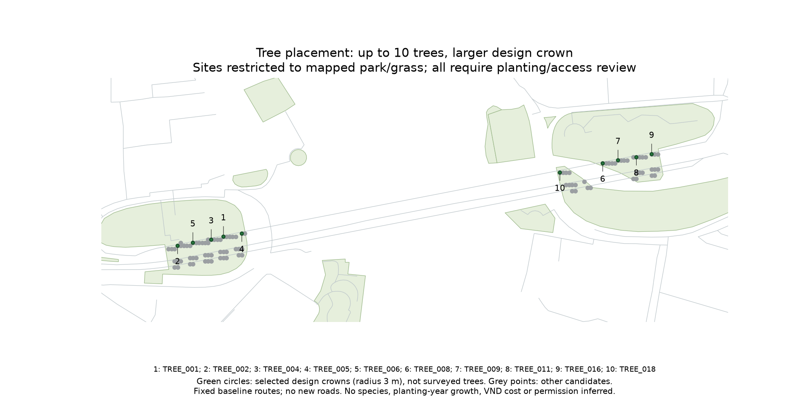
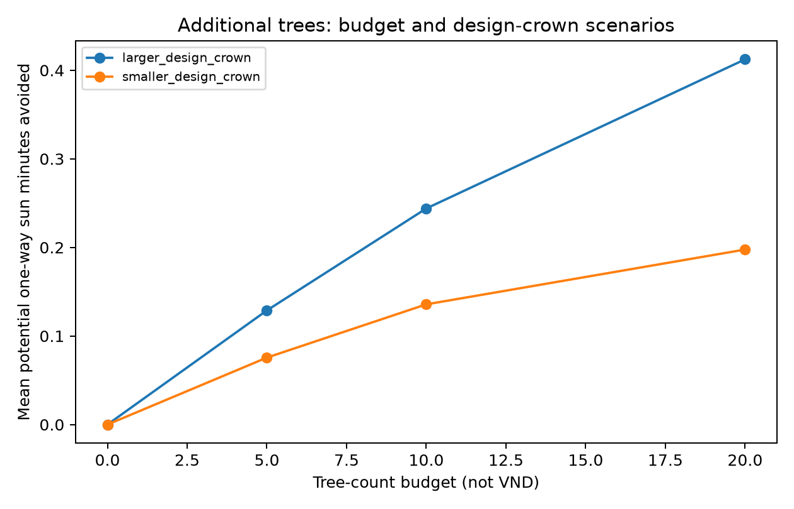

# Thao Dien Metro Station Shading - Walkability Optimization

This project uses mixed-integer linear programming (MILP) to select tree-planting locations around Thao Dien metro station in Ho Chi Minh City. The objective is to reduce sun exposure on existing walking routes, subject to a limit on the number of trees.

## Method

Population cells are assigned to their shortest walking routes to the station. Existing shade is estimated from building and canopy heights. Candidate trees are placed in mapped park or grass areas, and their additional shade is calculated at 09:00, 12:00 and 15:00 on 1 November 2026.

The model selects the combination of trees providing the greatest additional shade, weighted by the population using each route. Overlapping shade is counted once. Routes remain fixed after planting.

The main decisions and constraints are:

- Select a tree site or leave it unselected.
- Plant no more than the allowed number of trees.
- Count a shaded route sample only when a selected tree can shade it.
- Do not select sites that violate minimum tree spacing.

## Data

This repository includes the **processed optimization inputs**, rather than nationwide rasters or full building archives:

| File | Content |
|---|---|
| `data/candidate_review.csv` | 100 candidate sites, coordinates, OSM review links and reference selection |
| `data/coverage_patterns.csv` | Route samples grouped by the trees capable of shading them, with population-weighted benefit coefficients |
| `data/spacing_conflicts.csv` | Site pairs that cannot be selected together; empty for this aligned candidate grid |
| `data/metadata.json` | Population denominator, crown dimensions, time weights and assumptions |

The coverage table is derived from OSM, WorldPop, Meta/WRI canopy heights and UT-GLOBUS building heights. It reproduces the site-selection stage; this compact repository does **not** regenerate geographic inputs or the original shadow simulation. See [DATA_SOURCES.md](DATA_SOURCES.md) for sources and processing details.

## Run

Python 3.11 or newer is required. From the repository folder:

```bash
python -m venv .venv
# Activate .venv with the command appropriate for your operating system.
python -m pip install -r requirements.txt
python run_model.py
python -m pytest -q
```

The script writes `results/reproduced_summary.csv` and checks its benefit values against the saved results. Different site sets may be equivalent optimal solutions.

## Main results

Mean sun-exposed minutes avoided per potential one-way access trip, weighted by residential population and averaged across the three time snapshots:

| Maximum trees | Smaller crown | Larger crown |
|---|---:|---:|
| 0 | 0 | 0 |
| 5 | 0.076 | 0.129 |
| 10 | 0.136 | 0.244 |
| 20 | 0.198 | 0.412 |

The smaller crown has a 2 m radius, 3 m base and 6 m top. The larger crown has a 3 m radius, 3 m base and 9 m top. These are design assumptions, not species-specific growth predictions.

For 10 larger-crown trees, the mean benefit is about **14.6 seconds across all 107,946 modeled reachable residents**, including those receiving no benefit. This is a reduction in modeled sun exposure, not walking duration, temperature or observed daily passenger time.





## Scope

The budget is tree count, not money. All sites still require checks of soil, ownership, underground utilities, road clearance and planting permission. Heights, fixed routes and population weights have uncertainty. The optimum applies to the retained 100 candidates; it does not establish a construction-ready plan or an economic return.

Saved results include the eight scenario summaries and hourly benefits. Model code is in `src/model.py`; the small test suite checks budget, overlap, spacing and dataset integrity.
